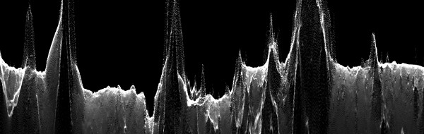
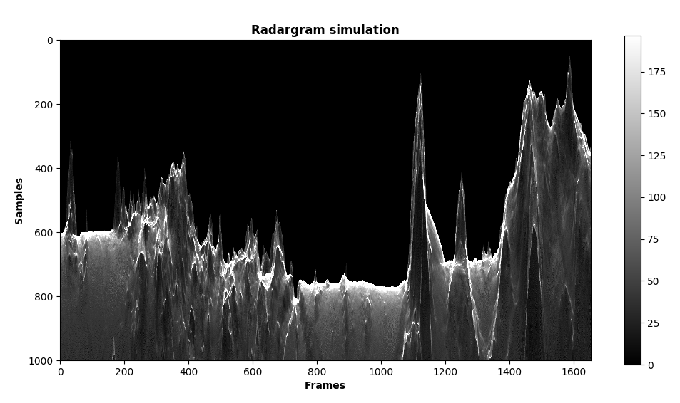
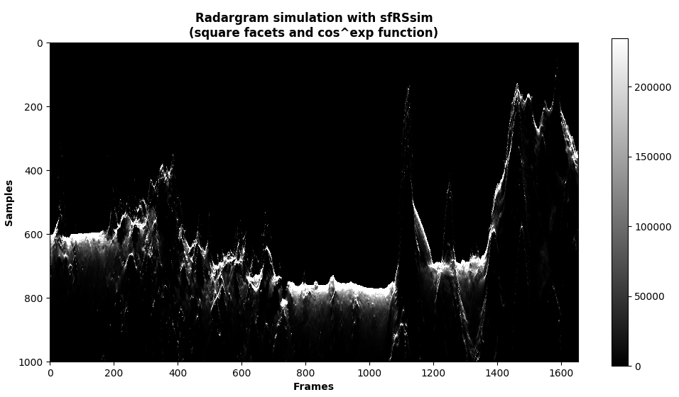
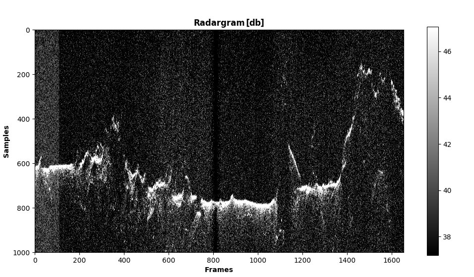
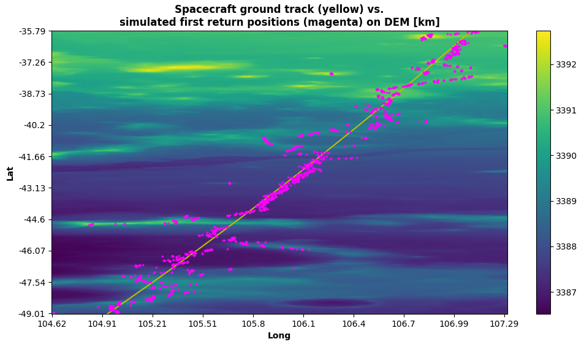
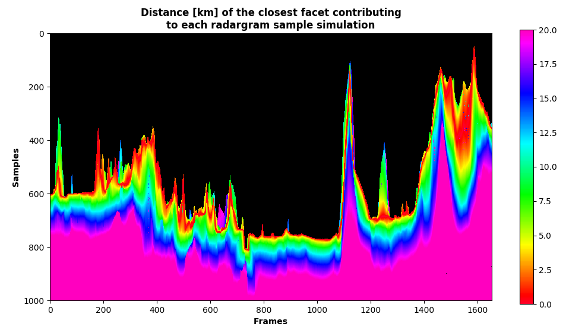

# SOPA — SHAllow RADar Open Processing Attempt



*A surface clutter simulation of SHARAD orbit 1061401 from PDS EDR data, produced with SOPA.*

## What is SOPA?

SOPA means SHARAD Open Processing Attempt. SOPA is thought to be a suite, let's say a *soup*, of open source algorithms for SHAllow RADar (SHARAD) low-level data processing written in Python, all sharing the same API. SHARAD is the radar sounder on board NASA's Mars Reconnaissance Orbiter.

This repository is the modernized version of the suite: the same algorithms, with byte-identical scientific outputs, brought to current coding and packaging standards.

**NOTE:** This project has not been developed during my work at the University of Trento, nor it has been supported by the University of Trento in any way.

## What's in the suite

- **data reading** with a common interface for:
  - [PDS Italian EDR raw data](https://pds-geosciences.wustl.edu/mro/mro-m-sharad-3-edr-v1/) (echoes and geometric data\*);
  - [PDS Italian RDR focused data](https://pds-geosciences.wustl.edu/mro/mro-m-sharad-4-rdr-v1/) (echoes and geometric data\*);
  - [CO-SHARPS raw data](http://psi.edu/SHARAD) (echoes and full ancillary dataset);
  - [PDS US RDR focused data](https://pds-geosciences.wustl.edu/mro/mro-m-sharad-5-radargram-v1/mrosh_2001/) (echoes and geometric data\*\*);
- an "essential" version of **[SOFA (SHARAD Open Focusing Attempt)](http://af-projects.it/sofa)**, a focuser that, besides standard nadir focusing, allows squinted synthetic aperture radar processing\*\*\*;
- **surface clutter simulators**\*\*\*\*:
  - dRSsim, a dummy radar sounder surface clutter simulator;
  - sfRSsim, an enhanced simulator using square facets that can use a cos^exp law to weight the effect of surfaces not facing the radar;
- **plotting tools** for quick visualization of focused radargrams, simulations, ground distance images, and first return maps superimposed to the DEM.

Notes:

\*Orbits extracted from PDS Italian data may be not sufficiently precise for data acquired before 2013.

\*\*Orbits extracted from PDS US RDR data may be not sufficiently precise for supporting simulations and or focusing.

\*\*\*By now, SOFA can handle only night time radargrams as no correction of ionosphere effects has been implemented yet.

\*\*\*\*The simulation principles are similar to those described in [this paper](https://dx.doi.org/10.1109/TGRS.2012.2219315).

## Status (2027)

SOPA_2027 is the modernization of the 2026 port of the original 2016–2019 suite: type hints throughout the library, a pytest suite of 288 tests, ruff for linting and formatting, and src-layout packaging (an installable `sopa` package). It runs on Python 3.14 with pinned numpy 2.5.4, scipy 1.18.1 and matplotlib 3.11.2 — `requirements.txt` is the fidelity contract, since byte-identical floating point requires identical binaries. Every product this version writes is byte-identical to the 2026 baseline; this is verified mechanically, run after run, by a byte-fidelity gate in the development workspace.

## Installation

There is no PyPI release: SOPA is installed from source only. Python 3.14 is required.

```bash
git clone https://github.com/adamoferro/sopa-2027.git
cd sopa-2027
python3.14 -m venv .venv
source .venv/bin/activate
pip install -e .
```

For development, install the test extra (`pip install -e ".[test]"`) to also get pytest. Interactive plotting uses the Qt backend (`pip install -e ".[qt]"`); without a display the plot windows are simply skipped and the products are still written to disk.

## Usage

Reading data through the common interface (here a PDS Italian EDR product; the reader derives the label, ancillary and data file names from `filename_base`):

```python
from sopa.input.sharad.data.edr.pds import EDR
from sopa.log.log import logger

lg = logger(verbose=True)

d = EDR(
    dataset_name="edr1260201",
    filename_base="/data/sharad/edr1260201/e_1260201_001_ss19_700_a",  # base name, without suffixes
    logger=lg,
)
d.load(mode="full")        # echoes + orbit ancillary data
d.generate_orbit_data()    # spacecraft orbit derived from the geometric data

print(d.data.shape)        # the echoes, as a numpy array
```

An example program running the complete processing chain end to end — EDR load, orbit data generation, sfRSsim simulation, SOFA focusing, ENVI output and the companion plots — is in the root of the project: `run_sopa_processing_2610.py`. It needs a real SHARAD product and the MOLA128 DEM: edit the input path constants near the top of its `main()` to point at your data. It runs on a single core and takes hours.

Two dataless checks, useful right after installation:

```bash
pytest tests/test_smoke.py    # the whole chain on fully synthetic data, ~1 min
pytest -m "not realdata"      # the full dataless test suite (~2 min, no real data needed)
```

The test suite selects the non-interactive matplotlib backend automatically, so it runs headless.

## Example gallery

All figures below are outputs of the 2019 suite, computed from CO-SHARPS observation 0894601 (input data downloaded from [CO-SHARPS](http://psi.edu/SHARAD)). Images © Adamo Ferro.

**Surface clutter simulation of SHARAD radargram 0894601 using SOPA's dummy RS simulator (dRSsim)**



**Surface clutter simulation of SHARAD radargram 0894601 using SOPA's square facet RS simulator (sfRSsim)**



**SHARAD radargram 0894601 focused using SOPA's focuser (SOFA)**



**Spacecraft track of radargram 0894601 and estimated positions of first returns superimposed to MOLA DEM**



**Minimum ground distance from the nadir point of the surface clutter contributions for each simulation sample**



## Project history

- **2016–2019** — SOPA, the original suite ([github.com/adamoferro/sopa](https://github.com/adamoferro/sopa)), presented on [af-projects.it/sopa](http://af-projects.it/sopa) with an [examples page](http://af-projects.it/sopa-examples). Its README is kept at the bottom of this page.
- **2026** — SOPA_2026, a port of the original code to the current stack (Python 3.14, numpy 2.5.4, scipy 1.18.1, matplotlib 3.11.2), kept as the frozen fidelity baseline.
- **2027** — SOPA_2027, this repository: the modernization of the port, one verified step at a time, with byte-identical outputs.
- A self-hosted web application built on top of this library lets users upload SHARAD files and run the processing from a browser.

## License and acknowledgment

SOPA is free software, distributed under the [GNU General Public License v3](LICENSE) (GPLv3 or later). Copyright © 2016–2026 Adamo Ferro.

> The use of SOPA or part of it for the creation of any sub-product (e.g., scientific papers, posters, images, other softwares) must be acknowledged.

---

# SOPA (original 2019 README, kept for reference)

SOPA is thought to be a suite of open source algorithms for SHAllow RADar (SHARAD) low-level data processing written in python v3.

At the time of writing the suite includes:
- data reading with common interface for:
  - PDS Italian EDR raw data (echoes and geometric data*);
  - PDS Italian RDR focused data (echoes and geometric data*)
  - CO-SHARPS raw data (echoes and full ancillary dataset);
  - PDS US RDR focused data (echoes and geometric data**);
- an "essential" version of SOFA (SHARAD Open Focusing Attempt, http://af-projects.it/sofa), a focuser that, besides standard nadir focusing, allows squinted synthetic aperture radar processing***;
- surface clutter simulators****:
  - dRSsim, a dummy radar sounder surface clutter simulator;
  - sfRSsim, an enhanced simulator using square facets that can use a cos^exp law to weight the effect of surfaces not facing the radar;
- plotting tools for quick visualization of focused radargrams, simulations, ground distance images, and first return maps superimposed to the DEM.

Unfortunately, almost no documentation is provided. An example program showing how to use the main functions can be found in the root of the project.

*Orbits extracted from PDS Italian data may be not sufficiently precise for data acquired before 2013.

**Orbits extracted from PDS US RDR data may be not sufficiently precise for supporting simulations and or focusing.

***By now, SOFA can handle only night time radargrams as no correction of ionosphere effects has been implemented yet.

****The simulation principles are similar to those described in http://dx.doi.org/10.1109/TGRS.2012.2219315.


Feel free to contact me for any help (contacts here: http://af-projects.it/contacts).

***NOTE:** This project has not been developed during my work at the University of Trento, nor it has been supported by the University of Trento in any way.*

### Requirements (original)
SOPA has been tested only in a Linux environment using python v3.5 and the following modules:
- sys
- math
- os
- glob (needed only for parsing CO-SHARPS data)
- datetime
- gzip (needed only if txt files related to CO-SHARPS ancillary data have been downloaded gzipped)
- numpy 1.17.4
- scipy 1.3.2
- bitstring (needed only for PDS Italian EDR data)
- ray 0.7.3 (needed only for parallel computation in surface clutter simulators and SOFA, not mandatory)
- matplotlib 3.0.3 (needed only for plotting classes)

### Current version
0.02

### Disclaimer

The author does not guarantee that this software will always provide correct results nor that it will not crash your hardware. In any case, any use of SOPA is ONLY user responsibility. The use of SOPA or part of it for the creation of any sub-product (e.g., scientific papers, posters, images, other softwares) must be acknowledged.
As you may imagine, the code is not optimized for fast running.
